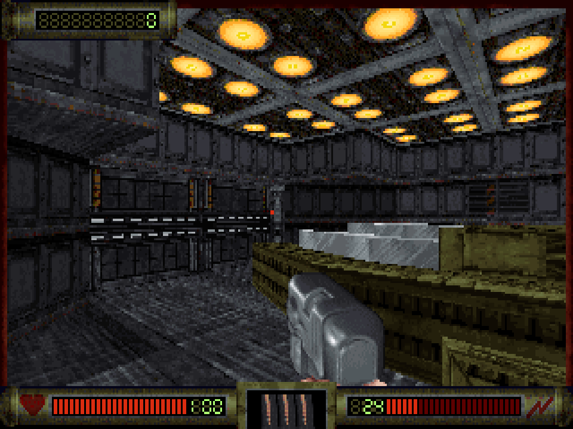
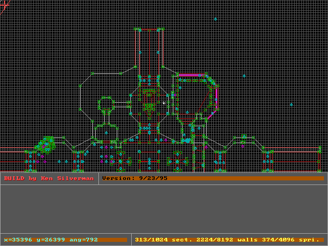

# LameDuke

A work-in-progress C rebuild of the December 30, 1994 Duke Nukem 3D beta
known as LameDuke. The game and its early Build engine behavior are being
recovered from `D3D.EXE`, with SDL2 providing the modern platform layer and
CMake building for Windows, macOS and Linux.

| In game: E1L1 with the status bar | BUILD editor: L1 in 2D mode |
|---|---|
|  |  |

## The reconstruction

The goal is to run the beta's original loose data files and reproduce what
`D3D.EXE` does: its classic renderer, demos and local gameplay. Each function
is rebuilt in C from the DOS executable, and source comments cite the exe
addresses (`0x249B0`) and globals they come from. Where the port knowingly
differs from the exe, such as guarding a read the exe made out of bounds, the
comment says so. The modern parts are added beside the original rather than
over it: the SDL2 platform layer, the Polymost renderers from the later
Build source, Video Options, and a BUILD map editor for this beta's maps.

Status: attract demos, local play, menus, sound effects and FM music work.
The Classic renderer and game behavior are still being compared against the
DOS executable. Multiplayer is stubbed out, the joystick menu item does
nothing, and only the Sound Blaster/FM sound paths are implemented. See
[docs/reconstruction.md](docs/reconstruction.md) for the method and the full
status.

## Quick start

Requirements: a C compiler, CMake 3.24 or newer, and SDL2. CMake uses an
installed SDL2 when it finds one; otherwise it downloads and builds SDL2
2.32.10, which requires network access. The default build also needs OpenGL
development libraries.

| OS | Setup |
|---|---|
| macOS | `brew install cmake sdl2` |
| Linux (Debian/Ubuntu) | `sudo apt install cmake build-essential libsdl2-dev libgl-dev` |
| Windows | Visual Studio with "Desktop development with C++" and CMake. SDL2 is fetched if it is not found. |

From the repository root:

```sh
cmake --preset default
cmake --build --preset default
```

The game is `build/bin/d3d` (`build/bin/d3d.exe` on Windows). Multi-configuration
generators put it under `build/bin/RelWithDebInfo/`. The `debug` preset builds
in `build-debug/` instead.

Run the game from the repository root, where it can find the data files:

```sh
./build/bin/d3d
./build/bin/d3d /v1 /l1
```

The first command starts the attract demos; the second starts episode 1,
level 1. Use `build\bin\d3d.exe` for these commands in Windows Command Prompt.
The original release notes are in [LAMEDUKE.TXT](LAMEDUKE.TXT).

`build/bin/build` is the BUILD map editor for this beta's maps, and
`build/bin/convmap4` converts the version-4 maps `L9.MAP` and `M8.MAP` to
version 5. See [docs/map-editor.md](docs/map-editor.md).

## Documentation

| Doc | What it covers |
|---|---|
| [Game sheet](docs/game-sheet.md) | Release, files, episodes and levels, demos, switches, enemies, weapons, items, music and controls |
| [Reconstruction](docs/reconstruction.md) | Method, where the port differs from the exe, source tree, test variables and tools, status |
| [Build engine](docs/build-engine.md) | Sectors, walls and sprites, sprite lists, collision, tiles, palette and the platform layer |
| [Rendering](docs/rendering.md) | Classic and Polymost renderers, presentation, game-side drawing and known gaps |
| [Audio and music](docs/audio.md) | The audio library, sound effects, MIDI and FM music, sound cards |
| [Network](docs/network.md) | The multiplayer remains, the sync stream and the demo format |
| [Menus](docs/menus.md) | Menu tree and keys, save and restore, Video Options |
| [CON script](docs/con-script.md) | The script language, its compiler and interpreter, every keyword |
| [Map format](docs/map-format.md) | Build map versions 5 and 4, field by field, and converting v4 |
| [Map editor](docs/map-editor.md) | Using the BUILD editor and what it saves |
| [Game speed](docs/game-speed.md) | The exe's timing, measured in DOSBox, and the port's fixed-rate loop |

## Game data

The repository contains the beta's loose maps, art, scripts, demos, palette,
tables, sounds and music. The game reads them from its working directory;
it does not use a GRP archive. `SETUP.DAT` supplies video, sound and input
settings. On case-sensitive filesystems, file lookup also tries a
case-insensitive match.

The original DOS executables and IDA databases are not tracked. The game data
and the Duke Nukem name remain subject to their respective copyright and
trademark holders' rights.

## Build options

Pass options with `-D` when configuring.

| Option | Default | Effect |
|---|---|---|
| `LAMEDUKE_FETCH_SDL` | `AUTO` | Use installed SDL2 or fetch it if missing; `ON` always fetches it and `OFF` requires an installed copy. |
| `LAMEDUKE_OPENGL` | `ON` | Require and link OpenGL for Polymost OpenGL. |
| `LAMEDUKE_POLYMOST` | `ON` | Build the Polymost renderers. Disabling this or OpenGL leaves Classic available. |

## Renderers and Video Options

Classic is the default 1994 indexed software renderer. Polymost Software
renders into an indexed buffer at a selected resolution; Polymost OpenGL
renders the world with OpenGL. Builds without OpenGL or Polymost offer Classic
only, and if OpenGL cannot start the game falls back to a working renderer.
`/p0`, `/p1`, `/p2` and `/p3` pick Classic, Polymost debug, Polymost Software
and Polymost OpenGL for one run without changing the saved choice.

Open **Game Options → Video Options** to choose renderer, resolution, display
mode, texture filtering, mip level, VSync, contrast, saturation and
supersampling. Changes are saved to `duke.cfg` in the working directory.
`SETUP.DAT` still supplies the Classic video mode and is not rewritten. See
[docs/rendering.md](docs/rendering.md) for details and known gaps.

### `duke.cfg`

The file is created in the working directory. Keys use `key = value`; `;`
starts a comment. Unknown keys are ignored and numeric values are clamped.
The editor uses the same keys in its own `build.cfg`.

| Key | Default | Values or range |
|---|---|---|
| `renderer` | `0` | `0` Classic, `2` software, `3` OpenGL; `1` in a file becomes `0` |
| `width` | `640` | 320–7680 |
| `height` | `480` | 200–4320 |
| `display` | `windowed` | `windowed`, `fullscreen`, `borderless` |
| `vsync` | `1` | `0` or `1` |
| `filter` | `nearest` | `nearest`, `bilinear`, `trilinear` |
| `miplevel` | `0` | 0–15 |
| `contrast` | `1` | 0.5–1.5 |
| `saturation` | `1` | 0–2 |
| `supersample` | `off` | `off`, `2k`, `4k`, `8k` |

## Project layout

| Path | Contents |
|---|---|
| `source/` | Game simulation, CON compiler and interpreter, demos, and menus. |
| `source/build/` | Reconstructed Build engine, renderers and platform code. See [VENDORED.md](source/build/VENDORED.md). |
| `source/audiolib/` | The audio library: digital sound, MIDI and the OPL emulator; other DOS cards are stubs. |
| `source/editor/` | The BUILD map editor. |
| `tools/` | `mapcheck`, `cfgcheck` and `convmap4`. |
| `docs/` | The docs above; `docs/superpowers/` holds the rebuild designs and plans. |

## License

The source code is under the GNU GPL v2 and Ken Silverman's Build Engine
license; see [LICENSE.md](LICENSE.md). The engine provenance and local
changes are described in [VENDORED.md](source/build/VENDORED.md). Neither
license covers the original game and its data files.
